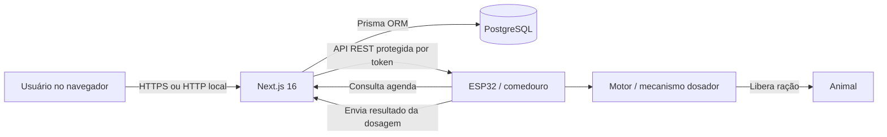

# PetFeed - Resumo técnico para apresentação

## 1. Visão geral do projeto

O PetFeed é um sistema web para programar e acompanhar a alimentação automática de animais. Ele integra uma aplicação web com comedouros físicos por meio de uma API HTTP.

O sistema permite:

- cadastrar usuários e autenticar acessos;
- cadastrar rações e suas características;
- cadastrar comedouros e medir sua vazão;
- cadastrar animais e associar ração e comedouro;
- criar horários de alimentação por dia da semana;
- enviar os horários ativos ao comedouro;
- receber registros da execução da dosagem;
- informar se a ração foi ministrada, não foi ministrada ou teve falha.

O projeto é composto por três partes:

1. Front-end web: interface visual usada pelo tutor.
2. Back-end: regras de negócio, autenticação, banco de dados e APIs.
3. Dispositivo físico: comedouro com ESP32 ou controlador equivalente, motor e sistema de acionamento.

## 2. Arquitetura geral



### Componentes

- **Next.js 16**: framework que concentra front-end, páginas, Server Actions e APIs HTTP.
- **React 19**: construção dos componentes e formulários da interface.
- **TypeScript**: tipagem das entidades e da comunicação entre as partes.
- **Prisma 6**: comunicação segura e organizada com o banco PostgreSQL.
- **PostgreSQL 16**: persistência dos usuários, rações, comedouros, animais, horários e histórico.
- **Docker Compose**: inicialização do banco PostgreSQL em ambiente local.
- **Tailwind CSS e CSS global**: recursos visuais e responsividade da interface.
- **ESP32 / comedouro físico**: consulta a agenda e ativa o motor conforme os horários.
- **JWE/Jose e bcrypt**: proteção da sessão e das senhas dos usuários.

## 3. Infraestrutura

### Banco de dados

O banco é executado em contêiner Docker:

- usuário: `comedouro`;
- banco: `comedouro`;
- porta externa: `5433`;
- PostgreSQL interno no contêiner: `5432`;
- dados persistidos em volume Docker `dados_pg`.

O arquivo `docker-compose.yml` cria e mantém o banco disponível. A persistência em volume permite que os dados não sejam perdidos ao reiniciar o contêiner.

### Conexão da aplicação

A aplicação usa as variáveis de ambiente do arquivo `.env`. Os principais dados são:

- `DATABASE_URL`: conexão com o PostgreSQL;
- `SESSION_SECRET`: chave usada para assinar os cookies de sessão.

Para desenvolvimento, o sistema é iniciado normalmente em `http://localhost:3000`. Em uma rede local, o servidor pode ser acessado pelo endereço IP da máquina que hospeda o projeto, por exemplo `http://172.20.96.1:3000`.

### Build e execução

O projeto possui os seguintes comandos principais:

- `npm run dev`: inicia o ambiente de desenvolvimento;
- `npm run build`: gera e valida a versão de produção;
- `npm run start`: inicia a aplicação já compilada;
- `npm run lint`: executa a análise estática do código.

O arquivo `package.json` define Next.js, React, Prisma, Zod, bcrypt, Jose e outras dependências utilizadas pelo sistema.

## 4. Modelo de dados

O banco possui os seguintes modelos principais:

### Usuario

Armazena nome, e-mail único e hash da senha.

### Racao

Contém nome, densidade em gramas por mililitro e fator de ajuste. Uma ração pertence a um usuário e pode ser usada por vários animais.

### Comedouro

Contém nome, vazão em mililitros por segundo, tempo máximo de acionamento e token de acesso exclusivo.

### Animal

Relaciona o usuário ao comedouro e à ração. Um animal pode ter vários horários de refeição.

### Horario

Contém hora, porção em gramas, dias da semana e estado ativo ou inativo. Os dias são representados por números de `0` a `6`, sendo domingo `0` e sábado `6`.

### Historico

Registra cada tentativa de dosagem. Guarda o horário previsto, o horário efetivo de início, duração do motor e status:

- `OK`: dosagem concluída;
- `FALHOU`: ocorreu uma falha;
- `PARADO`: dosagem interrompida.

Os relacionamentos garantem que o histórico pertença a um comedouro e, quando o horário ainda existir, a um horário específico.

## 5. Front-end

### Estrutura visual

O layout usa um menu lateral para computador e adapta-se para telas menores. A interface possui áreas para:

- painel inicial;
- animais;
- comedouros;
- horários;
- rações;
- cadastro e edição dos registros.

A camada visual é compartilhada pelo componente `AppShell`, que mantém o menu, o perfil do usuário e o botão de sair em todas as páginas privadas.

### Telas principais

#### Painel

Apresenta:

- próxima refeição;
- quantidade de refeições programadas no dia;
- número de rações cadastradas;
- agenda de hoje;
- comedouros cadastrados.

#### Animais

Permite cadastrar, editar e excluir pets. Cada animal pode ser vinculado a uma ração e a um comedouro.

#### Rações

Permite cadastrar a densidade da ração e um fator de ajuste. Esses dados são usados no cálculo da porção.

#### Comedouros

Permite cadastrar o nome, a vazão e o tempo máximo por dosagem. O token gerado identifica o dispositivo nas APIs.

#### Horários

Permite definir:

- hora;
- quantidade em gramas;
- dias da semana;
- estado ativo ou inativo.

Ao lado dos horários, o sistema apresenta a situação da refeição do dia. O status é atualizado a cada 30 segundos sem levar o usuário para outra tela.

### Atualização de status

A página consulta o histórico salvo no banco. Quando existe um registro da refeição no dia:

- status `OK` recebe a indicação "Poção ministrada";
- status `FALHOU` recebe "Falha ao ministrar";
- status `PARADO` recebe "Dosagem parada";
- ausência de registro recebe "Poção não ministrada".

Esse indicador depende da execução correta do envio da API pelo dispositivo.

## 6. Autenticação e sessões

O usuário se cadastra informando nome, e-mail e senha.

A senha é validada pelo Zod e armazenada com bcrypt usando custo 12. O sistema não salva a senha original.

No login:

1. o e-mail é localizado;
2. a senha informada é comparada com o hash;
3. em caso correto, uma sessão JWT é criada;
4. o token da sessão é armazenado em cookie HTTP-only.

O cookie de sessão expira em sete dias. O segredo usado para assiná-lo vem de `SESSION_SECRET`.

As páginas privadas usam a função `exigirUsuario` para confirmar que existe uma sessão válida e que o usuário ainda existe no banco.

## 7. Regras de negócio

### Cadastro da ração

Para calcular a densidade:

```text
densidade = peso da ração em gramas / 100 mL
```

O fator de ajuste permite corrigir diferenças práticas observadas entre o resultado esperado e a quantidade realmente liberada.

### Cálculo da porção

O sistema calcula quantos gramas o mecanismo libera por segundo:

```text
vazão em g/s = vazão em mL/s × densidade em g/mL × fator de ajuste
```

Depois calcula o tempo necessário:

```text
tempo em ms = porção em gramas / vazão em g/s × 1000
```

O tempo real usado pelo dispositivo é limitado pelo tempo máximo configurado no comedouro. Assim, a porção pode ser menor do que a solicitada quando o limite é atingido.

### Proteções contra erro

- horários devem estar no formato `HH:MM`;
- porções devem ficar entre 1 g e 1000 g;
- pelo menos um dia da semana deve ser escolhido;
- não são permitidos horários duplicados com mesmos animal, hora, porção e dias;
- animais, rações e comedouros são validados como pertencentes ao usuário autenticado;
- o comedouro possui um tempo máximo para funcionar como trava de segurança.

## 8. Comunicação com o comedouro

### Identificação do dispositivo

Cada comedouro possui um token exclusivo gerado no cadastro. O dispositivo envia esse token no cabeçalho HTTP:

```http
Authorization: Bearer <token-do-comedouro>
```

O servidor valida o token antes de liberar qualquer informação ou registrar dados.

### API de agenda

Endpoint:

```http
GET /api/dispositivo/agenda
```

A API retorna:

- fuso horário;
- tempo máximo permitido;
- lista de horários ativos associados aos animais daquele comedouro.

Cada item contém:

- ID do horário;
- hora;
- dias da semana;
- duração calculada em milissegundos.

O ESP32 usa esses dados para programar os acionamentos locais. O filtro por comedouro impede que um dispositivo receba horários de outro usuário.

### API de registro

Endpoint:

```http
POST /api/dispositivo/registro
```

O dispositivo envia:

- ID do horário;
- horário previsto;
- horário efetivo de início;
- duração do motor;
- status da operação.

O servidor valida o JSON, confirma que o horário pertence ao comedouro autenticado e cria um registro em `Historico`.

## 9. Fluxo completo de uma refeição

1. O usuário entra no sistema.
2. O usuário cadastra uma ração.
3. O usuário cadastra um comedouro e copia o token gerado.
4. O usuário cadastra o animal e informa a ração e o comedouro.
5. O usuário cria um horário no perfil do animal.
6. O back-end salva o horário no PostgreSQL.
7. O ESP32 consulta a API de agenda.
8. O ESP32 recebe a hora, os dias e a duração da dosagem.
9. Quando chega o horário programado, o motor é acionado.
10. Ao concluir ou falhar, o ESP32 envia o registro pela API.
11. O back-end valida o token e o horário.
12. O registro é salvo no histórico.
13. O site atualiza o status ao lado do horário.

## 10. Relação entre front-end e back-end

As páginas são renderizadas pelo Next.js e consultam diretamente o Prisma. As alterações feitas por formulários usam Server Actions, como:

- cadastro e edição de usuários;
- cadastro e edição de rações;
- cadastro e edição de comedouros;
- cadastro e edição de animais;
- criação, ativação, desativação e exclusão de horários.

O Next.js pode combinar interface React com execução no servidor. Isso permite que o banco seja acessado diretamente pelas páginas sem expor a API do Prisma ao navegador.

## 11. Estrutura principal do repositório

- `app/`: páginas, componentes e APIs.
- `app/actions/`: operações executadas no servidor.
- `app/api/dispositivo/`: endpoints do comedouro.
- `app/_components/`: layout, menu e componentes visuais comuns.
- `lib/`: autenticação, sessão, Prisma, dispositivo e cálculos.
- `prisma/schema.prisma`: modelos e relacionamentos do banco.
- `docker-compose.yml`: infraestrutura local do PostgreSQL.
- `app/globals.css`: estilos da interface.
- `package.json`: dependências e scripts.

## 12. Segurança atual

Pontos já implementados:

- senhas armazenadas como hash;
- sessão protegida por cookie HTTP-only;
- validação de formulários;
- verificação de propriedade dos registros;
- token exclusivo para cada comedouro;
- mensagem genérica em caso de login incorreto;
- limite máximo de tempo para acionamento.

Limitações atuais importantes para explicar em uma apresentação:

- o endereço local pode ser acessado apenas na rede onde o servidor está disponível;
- não há ainda domínio público ou implantação em nuvem;
- o token do comedouro é mostrado na própria interface e deve ser protegido;
- não há verificação de e-mail;
- não há recuperação de senha;
- não há controle de diferentes níveis administrativos;
- não há TLS configurado para o servidor local;
- o firmware do ESP32 não está incluído no repositório analisado;
- a comunicação depende da configuração correta do endereço IP e da rede do ESP32.

## 13. Pontos importantes da apresentação

Uma apresentação curta pode ser organizada assim:

### Introdução

"O PetFeed automatiza a rotina de alimentação de pets. O tutor configura rações, animais e horários em uma interface web. O sistema calcula o tempo necessário e envia os dados para o comedouro físico."

### Problema

"O tutor precisa lembrar horários, medir porções e acompanhar se a alimentação foi realizada. A solução centraliza agenda e acompanhamento."

### Solução

"O sistema possui uma aplicação Next.js, banco PostgreSQL, API para o ESP32 e mecanismo físico de dosagem."

### Diferenciais

- programação por dias da semana;
- cálculo automático baseado em densidade da ração;
- vínculo entre animal, ração e comedouro;
- trava de segurança pelo tempo máximo;
- histórico de dosagens;
- status visual de refeição;
- atualizações sem mudança da página.

### Fluxo demonstrado

"Cadastramos o comedouro, a ração e o animal. Em seguida, criamos um horário. Quando chega a hora, o ESP32 consulta a agenda, liga o motor pelo tempo calculado e envia o resultado ao servidor. Na tela, o status muda para Poção ministrada ou uma situação de falha."

### Tecnologias

"Next.js e React formam o front-end e o servidor; Prisma realiza o acesso ao PostgreSQL; Docker executa o banco; Zod valida dados; bcrypt protege senhas; o ESP32 comunica-se com a API."

### Encerramento

"A primeira versão entrega o cadastro completo, a automação da dosagem e o acompanhamento do histórico. Como evolução, podem ser adicionadas implantação em nuvem, notificações, conexão segura externa e monitoramento avançado do dispositivo."
